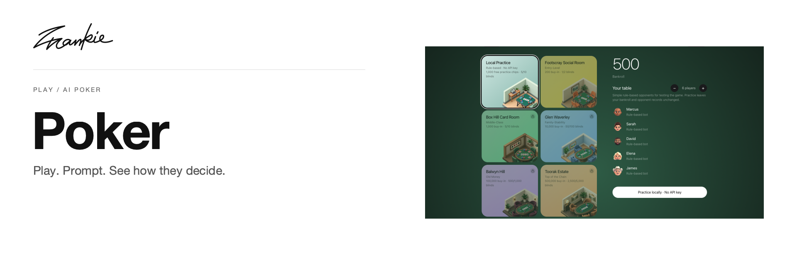

# Frankie Poker

[English](README.md) · [简体中文](README.zh-CN.md)

Play poker with language models. Give them a strategy. See how they play.

[Introduction](https://songhaifan.github.io/frankie-poker/) · [Agent guide](docs/agent-guide.md) · [Guide](docs/guide.md) · [Run locally](#run-locally) · [中文指南](docs/quickstart.zh-CN.md)

## What it does

- Try a key-free Local Practice table or choose opponents through OpenRouter.
- Give each opponent a model, play style and strategy prompt.
- Preview decisions for sample hands and extend the available poker information with plugins.

## Run locally

Use Node.js 22+ and npm.

```sh
npm ci
npm run dev
```

Open the Vite URL and choose **Local Practice** to start without an API key. OpenRouter setup is in the project guide.

## Before you start

Chips are virtual. Local Practice uses offline rules; other venues make model calls using your OpenRouter balance. This is an experimental playground, not a solved GTO engine or a controlled benchmark.

## For developers

```sh
npm run test:local
npm run build
```

Read [AGENTS.md](AGENTS.md), the [agent guide](docs/agent-guide.md), and the plugin instructions before changing strategy variables or algorithms.

[Project guide](docs/guide.md) · [Artwork](docs/readme/README.md)

---

Made by [Songhai Fan](https://github.com/SonghaiFan) · A Frankie project · [License](LICENSE)
