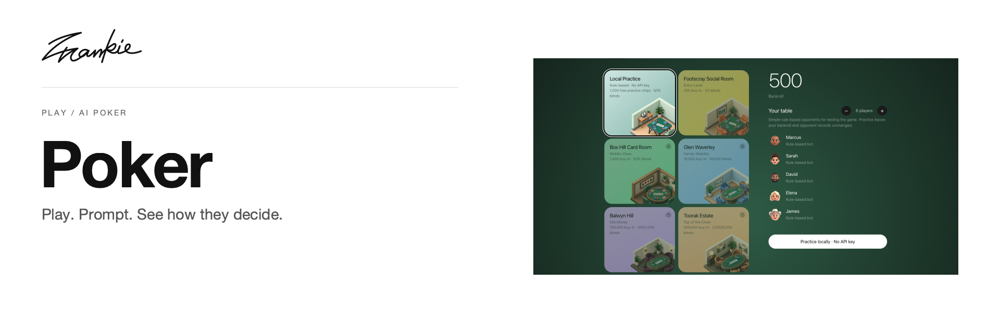

# Frankie Poker

[English](README.md) · [简体中文](README.zh-CN.md)

和语言模型一起打扑克。给它们策略，看看它们如何出牌。

[开发指南](docs/agent-guide.md) · [项目指南](docs/guide.md) · [本地运行](#本地运行) · [中文指南](docs/quickstart.zh-CN.md)

## 可以做什么

- 无需 key 即可体验 Local Practice，或通过 OpenRouter 选择对手。
- 为每个对手设置模型、打法与策略提示词。
- 预览示例手牌的决策，并通过插件扩展可用的扑克信息。

## 本地运行

使用 Node.js 22+ 和 npm。

```sh
npm ci
npm run dev
```

打开 Vite 地址，选择 **Local Practice** 即可无需 API key 开始。OpenRouter 配置见项目指南。

## 开始之前

筹码为虚拟筹码。Local Practice 使用离线规则；其他场馆会消耗你的 OpenRouter 余额调用模型。这是实验性游乐场，并非已求解的 GTO 引擎或受控基准测试。

## 开发说明

```sh
npm run test:local
npm run build
```

修改策略变量或算法前，请阅读 [AGENTS.md](AGENTS.md)、[开发指南](docs/agent-guide.md)与插件说明。

[项目指南](docs/guide.md) · [Banner 维护](docs/readme/README.md)

---

由 [Songhai Fan](https://github.com/SonghaiFan) 制作 · Frankie 系列项目 · [许可证](LICENSE)
